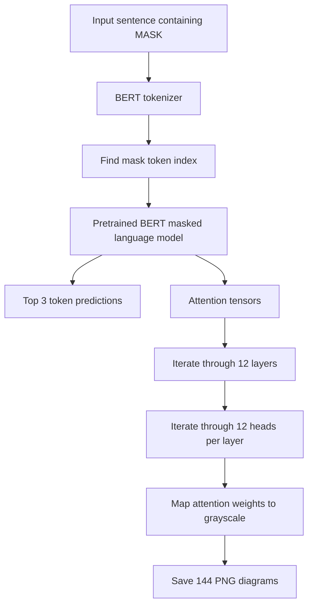

# Attention | BERT Masked Language Modeling & Self-Attention Visualization

**Harvard CS50's Introduction to Artificial Intelligence with Python — Project 6b (2024)**

**Topics:** Natural Language Processing · Transformers · BERT · Masked Language Modeling · Self-Attention · TensorFlow · Python

> **Project summary:** Explore how a pretrained BERT language model predicts a missing word using surrounding context, then generate and interpret grayscale attention maps from all 12 layers and 12 attention heads per layer.


---

## 1. Project overview

Masked language modeling trains or uses a language model to infer a hidden token from the tokens around it. This project uses **`bert-base-uncased`**, a pretrained **bidirectional Transformer**, to produce the top three candidate replacements for a `[MASK]` token in an English sentence.

It also makes the model's **self-attention** inspectable: for every attention head in every Transformer layer, the application saves a matrix as an image. Lighter cells represent larger attention scores; darker cells represent smaller ones.

**What this project does**

- Tokenizes input with Hugging Face's BERT tokenizer, including special tokens such as `[CLS]`, `[MASK]`, and `[SEP]`.
- Finds the position of the single masked token in the tokenized input.
- Loads a pretrained TensorFlow-compatible BERT masked-language model (`TFBertForMaskedLM`).
- Prints the **top 3 predicted token replacements** for the mask.
- Generates **144 attention maps**: 12 layers × 12 heads.
- Includes a self-contained analysis of **two tested sentences** and two attention heads, directly below.

> This is an exploration of a **pretrained** language model. The project does not train BERT from scratch, and attention visualizations are not, by themselves, proof of how the model makes a prediction.

---

## 2. Example: masked-token prediction

```text
Input:
The cat sat on the [MASK].

Observed output in a local test:
The cat sat on the floor.
The cat sat on the bed.
The cat sat on the couch.
```

Predictions can depend on the installed model/library versions. This is an example of a previously observed run, not a guaranteed output for all environments.

### Processing pipeline



---

## 3. Technical foundations

### 3.1 Bidirectional context and masked language modeling

Unlike a model restricted to reading only preceding text, BERT uses context from both sides of a masked position. The tokenizer maps each token to an integer ID, and the model produces a score for each vocabulary token at the masked position. The program selects the three highest-ranked candidates.

### 3.2 Self-attention

For each head, self-attention associates every query token with the tokens in the sequence. Conceptually, scaled dot-product attention is

```text
Attention(Q, K, V) = softmax((Q × Kᵀ) / √dₖ) × V
```

Here, `Q` represents queries, `K` represents keys, `V` represents values, and `dₖ` is the key-vector dimension. This notation expresses the conceptual computation without requiring a math-rendering extension.

The project visualizes the **attention-weight matrix** (the softmax weights), rather than the final contextualized token representations. Each image contains one row and one column per token, including special tokens.

### 3.3 Grayscale encoding

An attention score `s` between 0 and 1 (inclusive) is converted to an RGB grayscale intensity:

```text
I = round(255 × s)
RGB = (I, I, I)
```

| Attention score | RGB value | Appearance |
|---:|---|---|
| `0.00` | `(0, 0, 0)` | Black |
| `0.25` | `(64, 64, 64)` | Dark gray |
| `0.50` | `(128, 128, 128)` | Mid gray |
| `0.75` | `(191, 191, 191)` | Light gray |
| `1.00` | `(255, 255, 255)` | White |

The implementation converts the scalar attention score to a Python `float` before rounding; this also supports scalar values provided by TensorFlow tensors.

---

## 4. Architecture and source files

| File / directory | Purpose |
|---|---|
| `mask.py` | Tokenization, masked-token prediction, attention-head iteration, and PNG visualization. |
| `analysis.md` | Written interpretations of two attention heads based on two test sentences. |
| `requirements.txt` | Lists `pillow`, `tensorflow`, and `transformers`. |
| `assets/fonts/OpenSans-Regular.ttf` | Font resource read by the existing visualization function. |
| `experimentos/oracion_A1/` | **144** PNG attention maps for the first experiment. |
| `experimentos/oracion_A2/` | **144** PNG attention maps for the second experiment. |
| `experimentos_attention.zip` | Archived copy of the two experiments; optional when the expanded folders are retained. |
| `__pycache__/` | Auto-generated Python bytecode cache; not needed to run the project. |

The included archive contains **288 saved experiment images** (144 per sentence). The images are named `Attention_Layer<layer>_Head<head>.png`, with layer and head numbers starting at 1.

### Main functions

| Function | Responsibility |
|---|---|
| `get_mask_token_index(mask_token_id, inputs)` | Finds the mask ID within a batch of token IDs, or returns `None`. |
| `get_color_for_attention_score(attention_score)` | Converts one score to an RGB grayscale tuple. |
| `visualize_attentions(tokens, attentions)` | Iterates over every layer and head to generate the visualizations. |
| `generate_diagram(layer_number, head_number, tokens, attention_weights)` | Draws and saves an individual attention map (provided as part of the project starter). |

---

## 5. Installation and usage

### Requirements

- **Python 3.12** (the version recommended for this CS50AI assignment).
- Python package installer `pip`.
- Internet access **on the first execution** to download the pretrained BERT model/tokenizer.
- Enough disk space for the model files and generated PNGs.

### Windows PowerShell

From the project's directory:

```powershell
cd "X:\IO++\GitHub Upload\attention"
python --version
python -m pip install -r requirements.txt
python mask.py
```

At the prompt, enter a sentence containing **exactly one** `[MASK]` token:

```text
Text: The cat sat on the [MASK].
```

The program displays three predictions and writes the attention images **to the current working directory**.

### macOS / Linux

```bash
python3 -m pip install -r requirements.txt
python3 mask.py
```

**Compatibility note:** The provided `requirements.txt` specifies package names without fixed versions. Modern TensorFlow, Keras, and Transformers releases may require compatible version combinations. If a TensorFlow/Keras model-loading error appears, inspect the installed versions and consult the course's environment guidance before changing the project code.

**First-run note:** The initial run downloads `bert-base-uncased` model weights (approximately 440 MB in the observed environment). Subsequent runs generally reuse the Hugging Face cache.

---

## 6. Attention experiments and interpretation

Two sentences were tested with the pretrained `bert-base-uncased` model. Each run produced **144 attention matrices** (12 layers × 12 heads), for **288 saved visualizations across both runs**. The findings below are documented entirely in this README, with no linked images or other files required to understand them.

| Experiment | Input sentence | Generated attention maps |
|---|---|---:|
| **A1** | `The little dog chased the [MASK].` | 144 |
| **A2** | `The young student opened the [MASK].` | 144 |
| **Total** | **2 sentences** | **288** |

### 6.1 Layer 8, Head 11 — Determiner-to-noun association

**Observed pattern:** In both examples, the first determiner **`the`** attends comparatively strongly to the head noun of its noun phrase, **`dog`** or **`student`**, even though an adjective occurs between the words.

| Experiment | Noun phrase | Notable attention relationship | Interpretation |
|---|---|---|---|
| **A1** | `The little dog` | `the` → `dog` | The determiner attends to the head noun across `little`. |
| **A2** | `The young student` | `the` → `student` | The determiner attends to the head noun across `young`. |

**Interpretation:** Layer 8, Head 11 *may* help associate a determiner with a noun within the same noun phrase. This is a tentative interpretation of the inspected matrices; it is **not** evidence of a universally learned grammatical rule.

### 6.2 Layer 1, Head 4 — Attention to preceding tokens

**Observed pattern:** In both examples, some tokens direct relatively strong attention to nearby earlier tokens. In particular, **`chased`** attends noticeably to **`dog`** and **`opened`** attends to **`student`**.

| Experiment | Context | Notable attention relationship | Interpretation |
|---|---|---|---|
| **A1** | `dog chased` | `chased` → `dog` | A verb attends to a preceding neighboring token. |
| **A2** | `student opened` | `opened` → `student` | A verb attends to a preceding neighboring token. |

**Interpretation:** Layer 1, Head 4 appears to show a local **leftward attention preference** in these examples. Describing this as a local-context pattern is more defensible than claiming the head always recognizes subject–verb syntax.

### 6.3 How to interpret attention matrices

Each attention matrix has one row and one column per input token, including `[CLS]`, `[MASK]`, and `[SEP]`.

- **Rows:** the querying tokens that distribute their attention.
- **Columns:** the tokens receiving that attention.
- **Higher scores:** visually lighter cells in the program's grayscale output.
- **Lower scores:** darker cells.

The following conceptual table illustrates how to read a matrix. The labels are **illustrative**, not measured numerical scores from the experiments:

| Query token (row) | Key token (column) | What a highlighted cell would indicate |
|---|---|---|
| `the` | `dog` | Attention from the determiner toward the noun. |
| `chased` | `dog` | Attention from the verb to the preceding noun. |
| `the` | `[SEP]` | Attention to a special boundary token, which can also be common. |

**Scientific limitations:** Attention does not directly measure causal influence on a prediction. Some heads are noisy or favor special tokens. Two examples provide qualitative observations, **not statistical validation** of a fixed head-level function. The results should therefore be interpreted as hypotheses for further testing.

---

## 7. Regenerating and preserving images

When running `mask.py`, output images are written to the **current directory**. A later run reuses the same filenames, so preserve each set before testing the next sentence.

On Windows PowerShell, after a run:

```powershell
New-Item -ItemType Directory -Path ".\experimentos\new_test" -Force
Copy-Item "Attention_Layer*_Head*.png" ".\experimentos\new_test\"
(Get-ChildItem -File -Filter "Attention_Layer*_Head*.png").Count
```

The expected number is **144** when the complete 12-layer × 12-head visualization succeeds.

---

## 8. Skills demonstrated

- **Natural Language Processing:** tokenization, masked-language-model inference, contextual word prediction.
- **Deep Learning:** applying a pretrained bidirectional Transformer through TensorFlow and Hugging Face Transformers.
- **Model interpretability:** examining self-attention weight matrices and distinguishing observations from explanations.
- **Data visualization:** rendering tensor values to grayscale images with Pillow.
- **Python development:** functions, iteration over multidimensional data, dependency management, error diagnosis, and repeatable experiments.

### Potential future improvements

- Automatically create an output directory for each new sentence to prevent image overwrites.
- Generate summary sheets comparing selected heads across multiple inputs.
- Quantitatively test a proposed attention pattern across a larger set of sentences.
- Record and pin validated dependency versions in a separate reproducibility environment.

These are **possible extensions**, not features claimed to be implemented in the submitted code.

---

## 9. Academic context and attribution

This repository documents work completed as part of **Harvard CS50's Introduction to Artificial Intelligence with Python**. The original assignment and starter materials are provided by the CS50 course team. The project uses the pretrained **`bert-base-uncased`** model and libraries maintained by their respective authors.

- [Original CS50AI Attention assignment](https://cs50.harvard.edu/ai/projects/6/attention/)
- [Harvard CS50AI course](https://cs50.harvard.edu/ai/)
- [Verified course-completion certificate](https://cs50.harvard.edu/certificates/4d1848b5-b7cc-4b37-8155-819e19e6054d)
- [BERT research paper](https://arxiv.org/abs/1810.04805)

**Academic integrity:** CS50's academic honesty rules restrict sharing completed assignment solutions with others. This README is intended as a public-facing description of the project and its results; review the course policy before making any graded solution source files publicly accessible. Third-party model, data, and font files may have additional redistribution terms.

---

**Portfolio:** [GitHub — tjallemann01](https://github.com/tjallemann01)  
**Focus:** Artificial Intelligence · NLP · Transformers · Applied Machine Learning
